<a href="https://oondraa.pages.dev/">
  <picture>
    <source media="(prefers-color-scheme: dark)" srcset="assets/header-dark.svg" />
    <source media="(prefers-color-scheme: light)" srcset="assets/header-light.svg" />
    
  </picture>
</a>

  
  
  
  

 

<picture>
  <source media="(prefers-color-scheme: dark)" srcset="assets/sec-about-dark.svg" />
  <source media="(prefers-color-scheme: light)" srcset="assets/sec-about-light.svg" />
  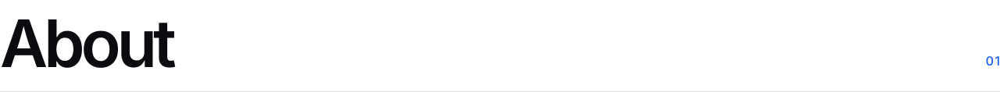
</picture>

I'm Ondřej Zajíček, but online mostly **oondraa**. I run the [OZDIGITAL](https://ozdigital.pages.dev/) studio and after hours I build my own things, where **software meets hardware**: desktop apps, web apps, dashboards and the occasional 3D-printed part.

Outside the editor: 3D printing · PC building · ESP32 / Arduino

 

<picture>
  <source media="(prefers-color-scheme: dark)" srcset="assets/sec-work-dark.svg" />
  <source media="(prefers-color-scheme: light)" srcset="assets/sec-work-light.svg" />
  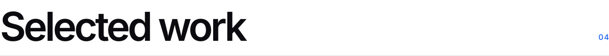
</picture>

<table>
  <tr>
    <td width="50%" valign="top">
      <a href="https://oondraa.github.io/OpenSISAKHK/">
        <picture>
          <source media="(prefers-color-scheme: dark)" srcset="assets/card-sis-dark.svg" />
          <source media="(prefers-color-scheme: light)" srcset="assets/card-sis-light.svg" />
          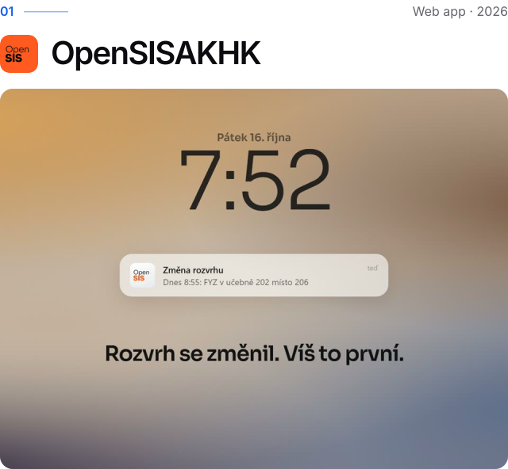
        </picture>
      </a>
      
My school in one app. Timetable with substitutions, grades with what you need on the next test, absences watched against the 30&nbsp;% limit, free classrooms, lunches, and a notification when the school rewrites the timetable at 3&nbsp;a.m.

      
<a href="https://opensisakhk.opensisakhk.workers.dev"><b>Open the app ↗</b></a> &nbsp; <a href="https://github.com/oondraa/OpenSISAKHK"><b>GitHub ↗</b></a>

      TypeScript · React · Cloudflare Workers
    </td>
    <td width="50%" valign="top">
      <a href="https://oondraa.github.io/OZBEAT/">
        <picture>
          <source media="(prefers-color-scheme: dark)" srcset="assets/card-ozbeat-dark.svg" />
          <source media="(prefers-color-scheme: light)" srcset="assets/card-ozbeat-light.svg" />
          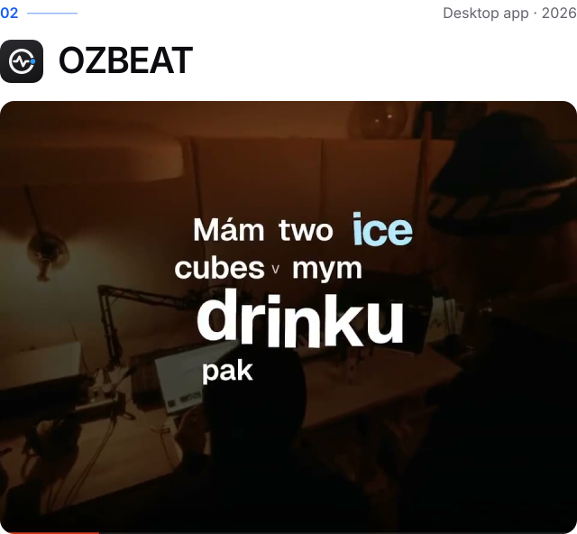
        </picture>
      </a>
      
Your music on the big screen. Lyrics word by word the moment they're sung, over the official music video or the cover's colours. For Spotify, YouTube and BluOS speakers, on your monitor, on the TV or as a screensaver.

      
<a href="https://oondraa.github.io/OZBEAT/"><b>Project site ↗</b></a> &nbsp; <a href="https://github.com/oondraa/OZBEAT/releases/latest/download/OZBEAT.exe"><b>Download for Windows ↓</b></a>

      Rust · WGSL
    </td>
  </tr>
  <tr>
    <td width="50%" valign="top">
      <a href="https://oondraa.github.io/ClaudeHUD/">
        <picture>
          <source media="(prefers-color-scheme: dark)" srcset="assets/card-hud-dark.svg" />
          <source media="(prefers-color-scheme: light)" srcset="assets/card-hud-light.svg" />
          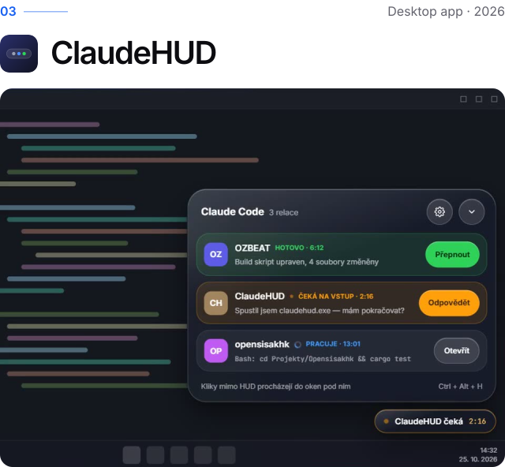
        </picture>
      </a>
      
A glass island in the bottom-right corner of Windows that watches every Claude Code session. When one finishes, fails or asks for permission, a card slides up and you approve it right where you are.

      
<a href="https://oondraa.github.io/ClaudeHUD/"><b>Project site ↗</b></a> &nbsp; <a href="https://github.com/oondraa/ClaudeHUD"><b>GitHub ↗</b></a>

      HTML · Windows
    </td>
    <td width="50%" valign="top">
      <a href="https://oondraa.github.io/OpenSosacTV/">
        <picture>
          <source media="(prefers-color-scheme: dark)" srcset="assets/card-sosac-dark.svg" />
          <source media="(prefers-color-scheme: light)" srcset="assets/card-sosac-light.svg" />
          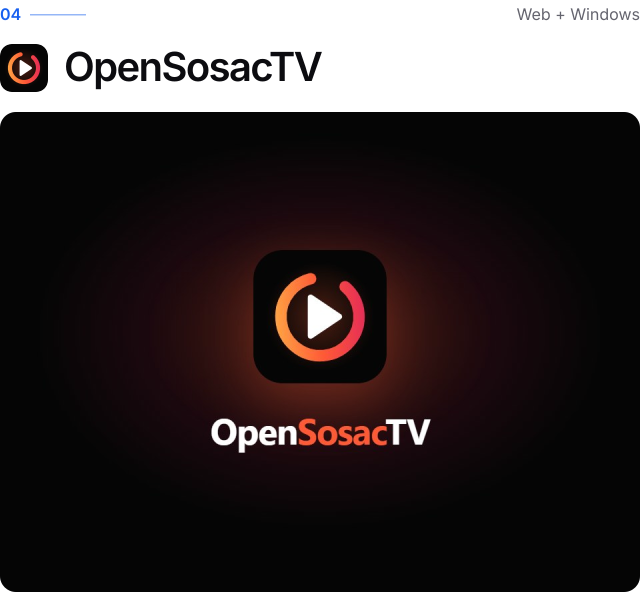
        </picture>
      </a>
      
An unofficial client for Sosáč and Streamuj.tv. A clean interface, profiles for the whole family and your own watchlist. A web app for your phone and a Windows program in Rust, with no server of its own.

      
<a href="https://oondraa.github.io/OpenSosacTV/"><b>Open the app ↗</b></a> &nbsp; <a href="https://github.com/oondraa/OpenSosacTV/releases/latest/download/OpenSosacTV.exe"><b>Download for Windows ↓</b></a>

      TypeScript · Rust · egui · WebView2
    </td>
  </tr>
</table>

Also: [**Spotify Live Wrapped**](https://github.com/oondraa/spotify-live-wrapped), a self-hosted 24/7 “Spotify Wrapped” with a listening-history collector and a live stats dashboard.

 

<picture>
  <source media="(prefers-color-scheme: dark)" srcset="assets/sec-stack-dark.svg" />
  <source media="(prefers-color-scheme: light)" srcset="assets/sec-stack-light.svg" />
  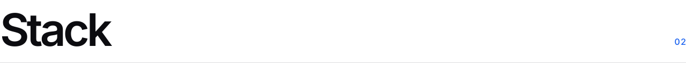
</picture>

  <picture>
    <source media="(prefers-color-scheme: dark)" srcset="https://skillicons.dev/icons?i=rust,ts,python,js,react,html,css,cpp,git,githubactions,cloudflare,linux,vscode,visualstudio,arduino&theme=dark&perline=15" />
    
  </picture>

 

<picture>
  <source media="(prefers-color-scheme: dark)" srcset="assets/sec-activity-dark.svg" />
  <source media="(prefers-color-scheme: light)" srcset="assets/sec-activity-light.svg" />
  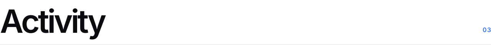
</picture>

  <picture>
    <source media="(prefers-color-scheme: dark)" srcset="https://streak-stats.demolab.com?user=oondraa&hide_border=true&border_radius=16&background=0c0c10&stroke=2a2a32&ring=1760f0&fire=5b93ff&currStreakNum=f1f1f3&sideNums=f1f1f3&currStreakLabel=5b93ff&sideLabels=8d8d97&dates=8d8d97" />
    
  </picture>

  <picture>
    <source media="(prefers-color-scheme: dark)" srcset="https://raw.githubusercontent.com/oondraa/oondraa/output/snake-dark.svg" />
    <source media="(prefers-color-scheme: light)" srcset="https://raw.githubusercontent.com/oondraa/oondraa/output/snake-light.svg" />
    
  </picture>

 

<a href="https://oondraa.pages.dev/#contact">
  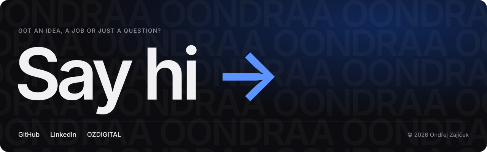
</a>
